# Dashboard nacional de redes e infraestructura

Proyecto de análisis y visualización de datos desarrollado por **David Aldana**, utilizando **PostgreSQL y Power BI**.

## Objetivo

Analizar el comportamiento de redes Wi-Fi y cableadas mediante indicadores de calidad de conexión y rendimiento de equipos, facilitando la exploración de los datos en un reporte interactivo.

## Indicadores analizados

- Latencia.
- Jitter o variación de la latencia.
- Pérdida de paquetes.
- Utilización de CPU.
- Utilización de memoria.
- Temperatura de equipos.

## Herramientas utilizadas

- **PostgreSQL:** almacenamiento y consulta de los datos.
- **Power BI Desktop:** desarrollo del reporte y sus visualizaciones.

## Descargar el reporte

[Ir a la descarga del dashboard — versión 1.0](https://github.com/david33-tech/Redes/releases/tag/v1.0)

En la sección **Assets / Activos** del lanzamiento, selecciona el archivo **.pbix**.

## Galería del reporte

### Página 1
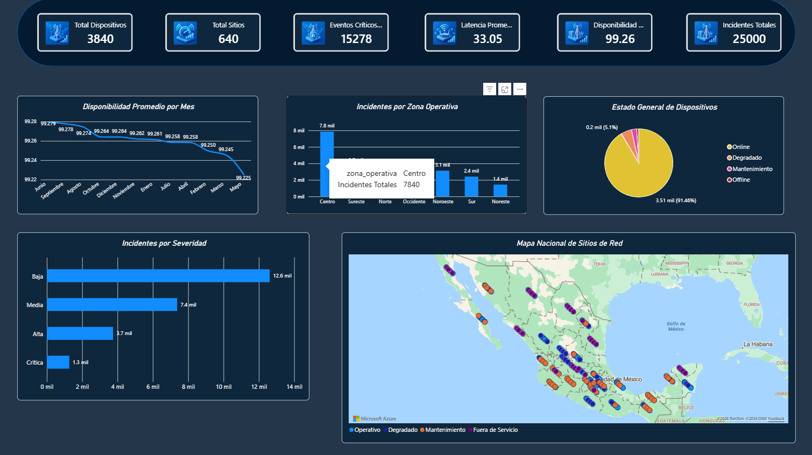

### Página 2
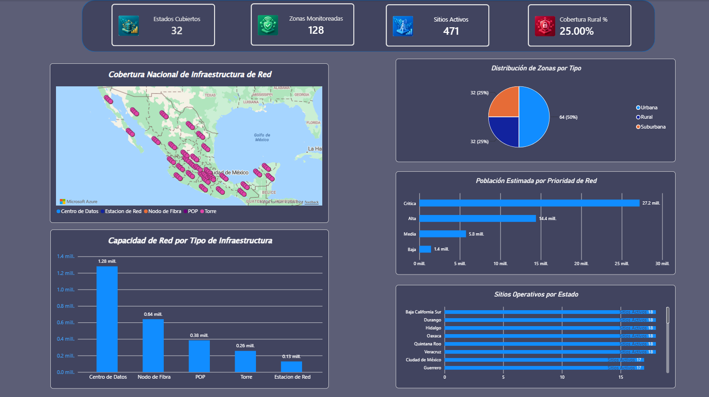

### Página 3
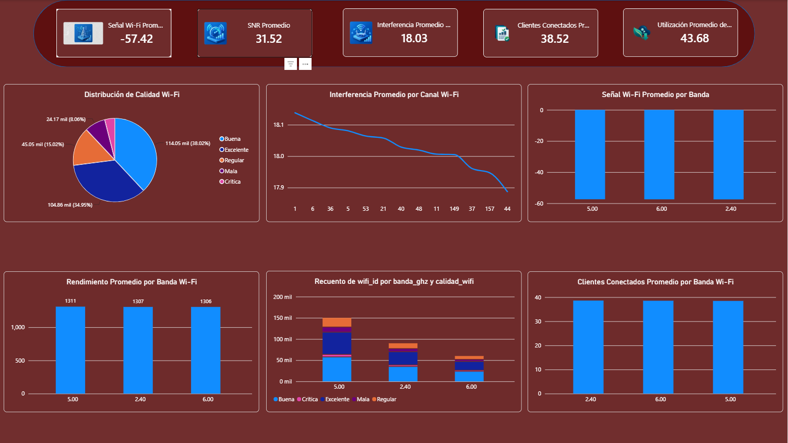

### Página 4
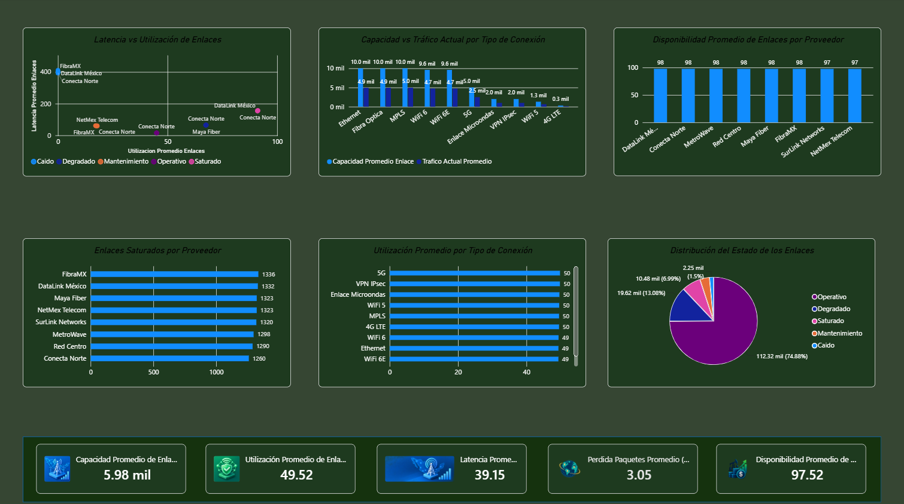

### Página 5
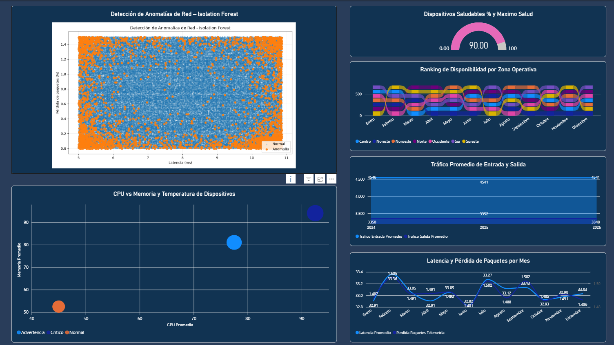

### Página 6
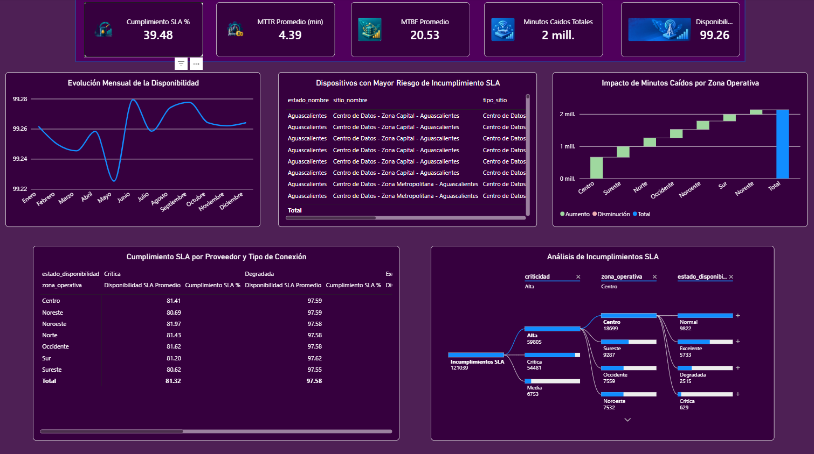

### Página 7
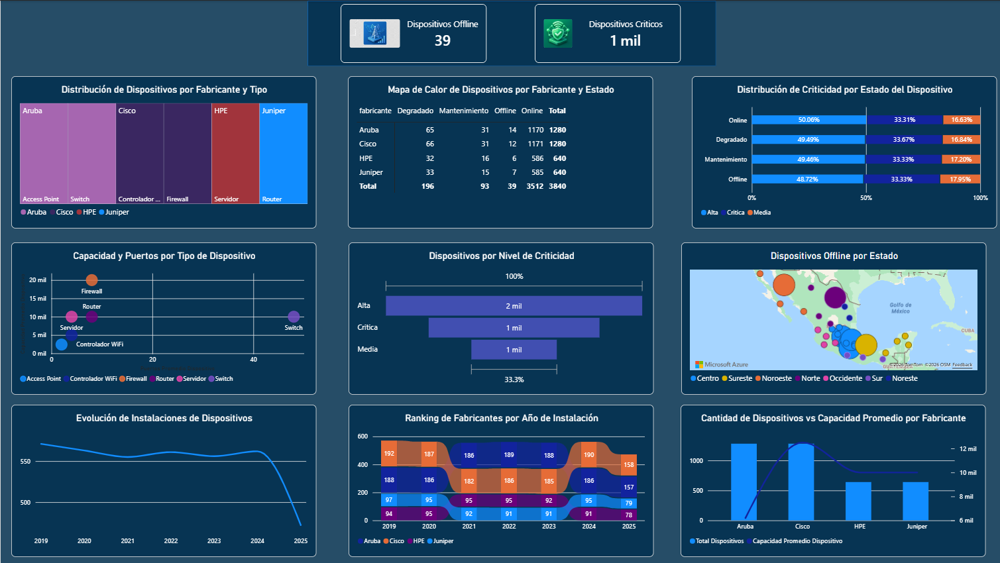

### Página 8
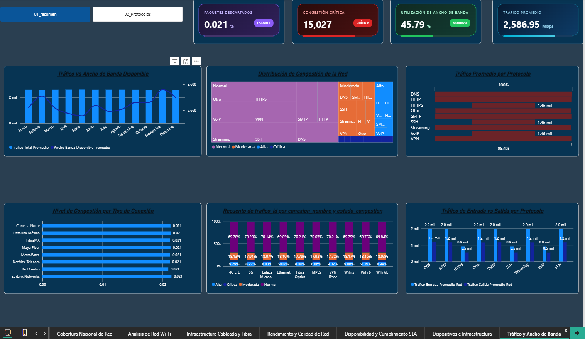

### Página 9
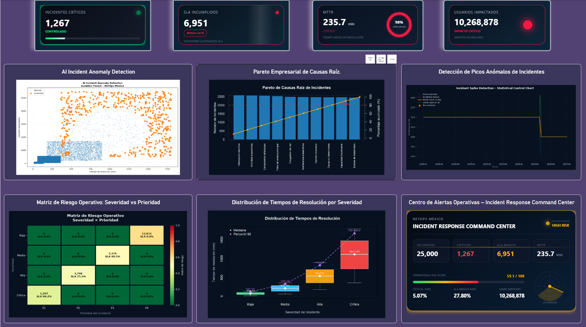

### Página 10
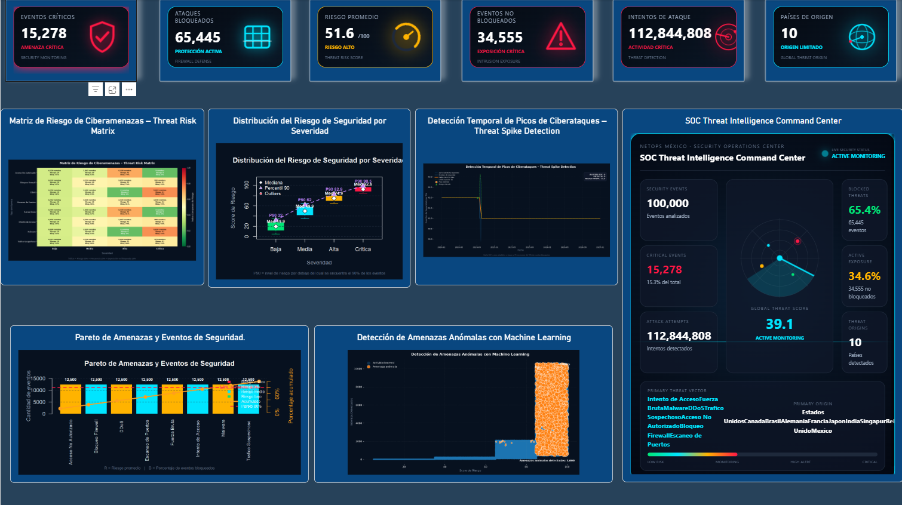

### Página 11
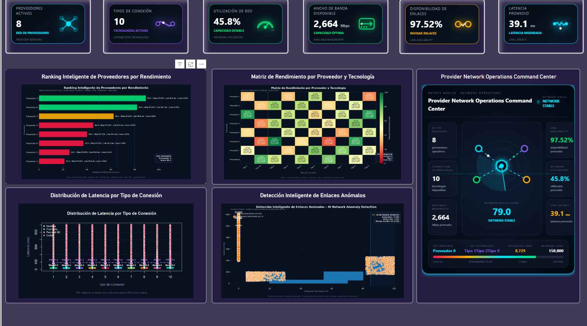

### Página 12
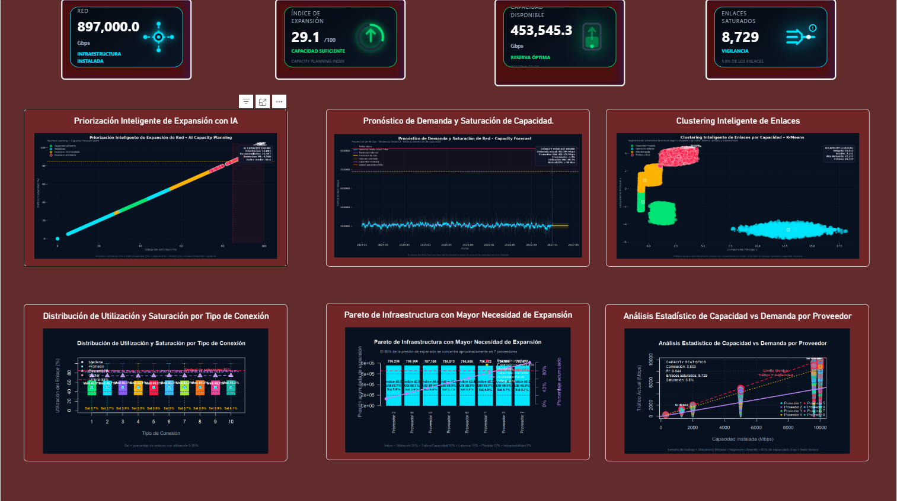

### Página 13
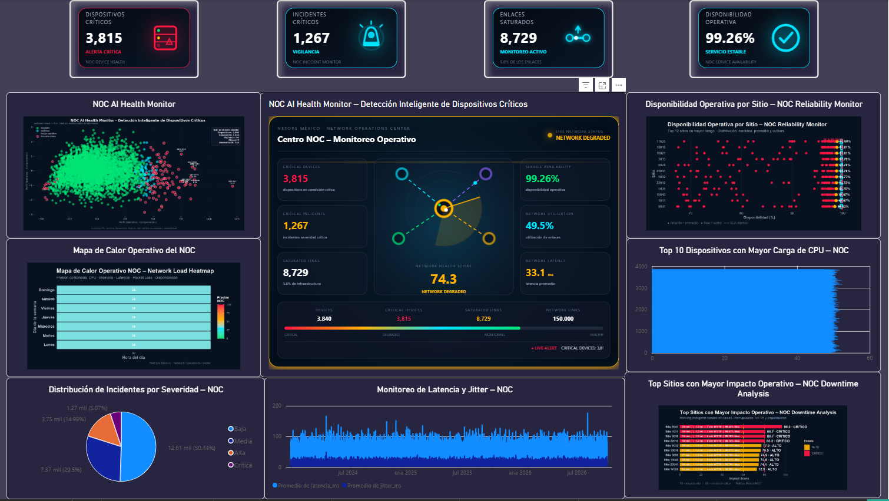

### Página 14
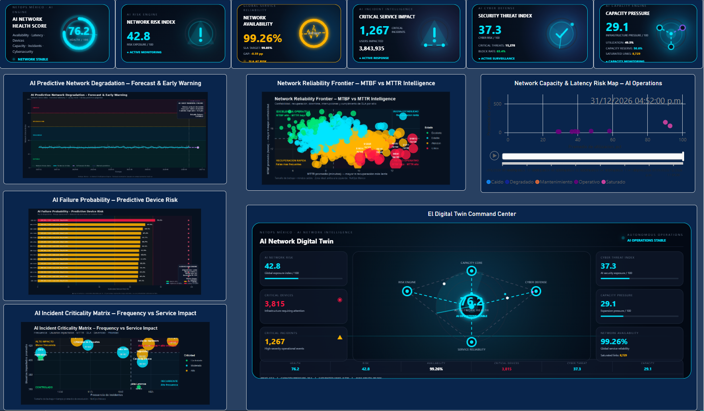

## Autor

David Aldana

